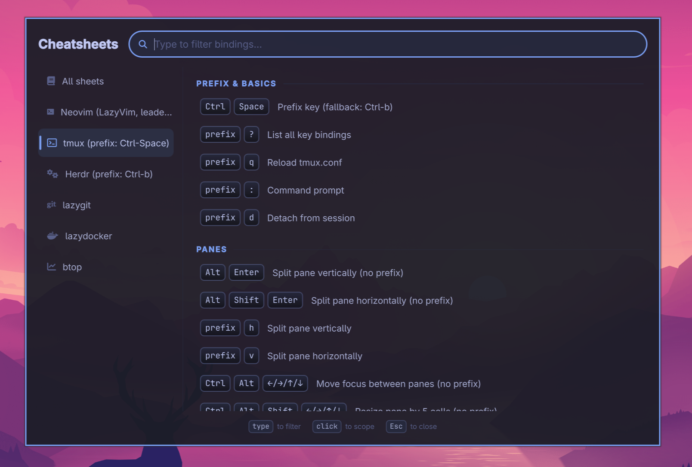

# omarchy-cheatsheets

Pretty, searchable cheatsheets for [Omarchy](https://omarchy.org/) Linux.
A small Qt6/QML window backed by Rust (cxx-qt): launch it, start typing,
the list narrows instantly.



**The goal is to show the real bindings available on your machine, not a
static cheatsheet like many others.** Sheets resolve against your actual
configs at launch: tmux bindings are read from a probe of your live
`tmux.conf` (overrides applied, unbound defaults dropped), Herdr bindings from
your merged `config.toml`, and prefix/leader keys are always read from your
setup. Tools with non-configurable keys (like btop) ship their documented
defaults; anything else can be adjusted via TOML overlays.

Ships curated sheets for **Neovim (LazyVim)**, **tmux**, **Herdr**,
**Zellij**, **lazygit**, **lazydocker**, and **btop** — tools not installed
on your system are hidden automatically.

## Install

```bash
yay -S omarchy-cheatsheets-bin   # prebuilt binary (AUR)
yay -S omarchy-cheatsheets       # build from source (AUR)
```

Omarchy shell users can also add the bar widget, which offers the AUR install
when the app is missing and launches it when present:

```bash
omarchy plugin add https://github.com/akitaonrails/omarchy-cheatsheets.git --enable
```

Runtime dependencies (`qt6-base`, `qt6-declarative`) are handled by the AUR
packages. Removal:

```bash
omarchy plugin remove akitaonrails.cheatsheets   # bar widget, if added
yay -R omarchy-cheatsheets-bin                   # or omarchy-cheatsheets
```

## Usage

```bash
omarchy-cheatsheets                  # all sheets
omarchy-cheatsheets --section nvim   # open scoped to one tool
omarchy-cheatsheets --list-sections  # machine-readable list of sheets
```

Suggested Hyprland bindings (`~/.config/hypr/bindings.lua`):

```lua
o.bind("SUPER + N", "Neovim cheatsheet", { launch = "omarchy-cheatsheets --section nvim" })
o.bind("SUPER + ALT + T", "Tmux cheatsheet", { launch = "omarchy-cheatsheets --section tmux" })
o.bind("SUPER + CTRL + SLASH", "Cheatsheets", { launch = "omarchy-cheatsheets" })
```

(SUPER+T is stock Omarchy's float toggle — hence SUPER+ALT+T.)

and a floating window rule (`~/.config/hypr/looknfeel.lua`):

```lua
o.window("^(omarchy-cheatsheets)$", { float = true, center = true, size = { 980, 660 } })
```

## Customizing sheets

Drop TOML files in `~/.config/omarchy-cheatsheets/`. Same sheet name + same
section + same `keys` replaces an entry; anything else is appended, so you can
reword bindings, add sections, or add whole new programs:

```toml
name = "tmux"
command = "tmux"      # optional: sheet hidden when not in PATH
icon = "\uf489"       # optional: Nerd Font glyph for the sidebar

[[sections]]
name = "Panes"

[[sections.entries]]
keys = ["prefix", "x"]
description = "Close pane"
tags = ["daily"]      # optional, free-form
```

## Development

Requirements: Rust 1.95 (pinned in `rust-toolchain.toml`), Qt6
(`qt6-base`, `qt6-declarative`), clang, cmake.

```bash
cargo t                                    # everyday test loop (nextest)
cargo tf                                   # full suite, pre-push
cargo clippy --workspace --all-targets -- -D warnings
cargo fmt --all -- --check
cargo deny check
```

Layout: `src/sheet.rs` (model), `src/load.rs` (embedded + overlay merge,
availability probe, prefix resolution), `src/resolve.rs` (live binding
resolution), `src/search.rs` (scoring), `src/bridge.rs` (cxx-qt QObject),
`qml/Main.qml` (all UI), `data/*.toml` (curated sheets), `plugin/` (Omarchy
shell bar widget). Rules and gates live in [AGENTS.md](AGENTS.md); adding a
new app's sheet is documented in [CONTRIBUTING.md](CONTRIBUTING.md).

## Release

```bash
bin/release 0.1.1   # gates + version bump + changelog + tag (does not push)
git push --follow-tags
```

Tagging `vX.Y.Z` runs `.github/workflows/release.yml`: builds x86_64 and
aarch64 tarballs, creates the GitHub release, and publishes both AUR packages
(when the `AUR_SSH_PRIVATE_KEY` secret is set).

## License

[GPL-3.0-only](LICENSE) © 2026 Fabio Akita (akitaonrails)
